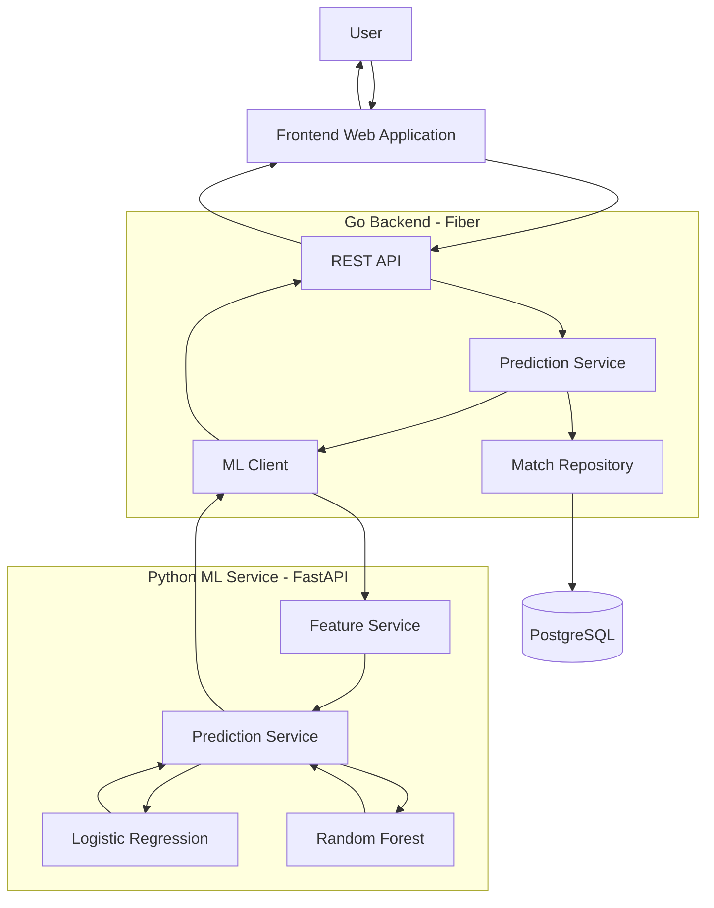
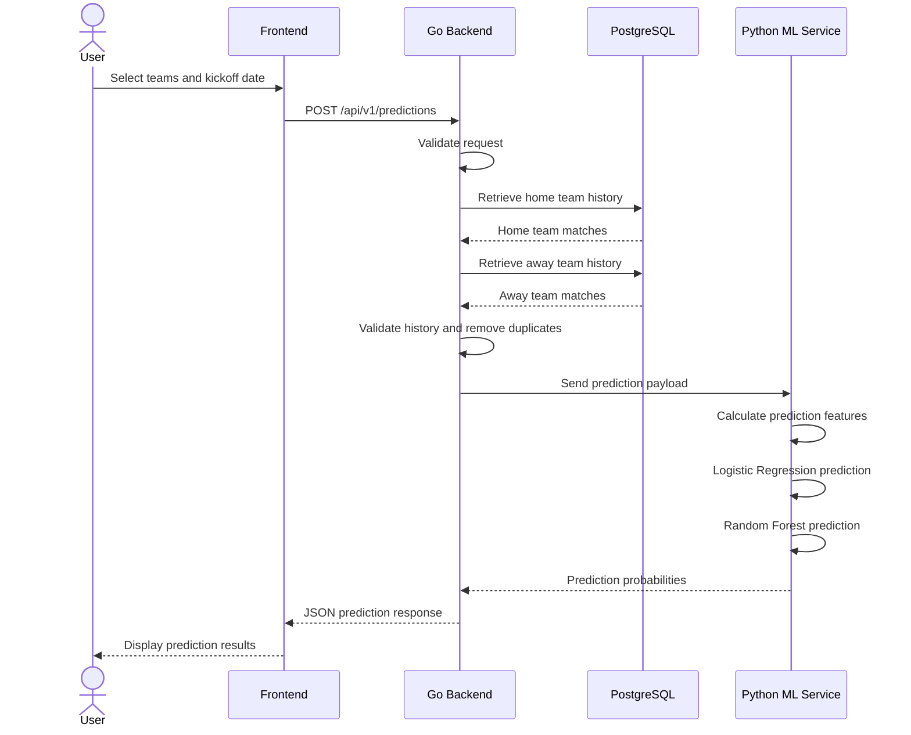

# System Architecture

## 1. Overview

EPL Prediction System merupakan aplikasi prediksi hasil pertandingan sepak bola English Premier League (EPL) berbasis web.

Sistem menggunakan dua algoritma machine learning, yaitu Logistic Regression dan Random Forest, untuk menghasilkan probabilitas tiga kemungkinan hasil pertandingan:

- Home Win (H)
- Draw (D)
- Away Win (A)

Sistem dikembangkan menggunakan arsitektur terpisah antara frontend, backend API, database, dan machine learning service.

## 2. Technology Stack

| Component            | Technology      |
| -------------------- | --------------- |
| Frontend             | Web Application |
| Backend API          | Go, Fiber v3    |
| Database             | PostgreSQL 17   |
| ORM                  | GORM            |
| Machine Learning API | Python, FastAPI |
| Data Processing      | Pandas, NumPy   |
| Machine Learning     | Scikit-learn    |
| Model Serialization  | Joblib          |
| Containerization     | Docker          |

## 3. System Architecture

Sistem terdiri dari empat komponen utama:

1. Frontend: menyediakan antarmuka pengguna untuk memasukkan pertandingan dan melihat hasil prediksi.
2. Go Backend: menerima request, mengambil data historis dari PostgreSQL, melakukan validasi, dan meneruskan data ke ML Service.
3. PostgreSQL: menyimpan data historis pertandingan EPL.
4. Python ML Service: mengolah data historis menjadi fitur prediksi dan menghasilkan probabilitas menggunakan Logistic Regression dan Random Forest.

### 3.1 Architecture Diagram

## 4. Prediction Request Flow

Proses prediksi dimulai ketika pengguna memilih tim kandang, tim tandang, dan tanggal pertandingan.

Alur proses:

1. Frontend mengirimkan HTTP POST request ke endpoint `/api/v1/predictions`.
2. Go Backend menerima dan memvalidasi input.
3. Prediction Service meminta riwayat pertandingan setiap tim melalui Match Repository.
4. Match Repository mengambil maksimal lima pertandingan terakhir untuk masing-masing tim dari PostgreSQL.
5. Sistem hanya menggunakan pertandingan dengan tanggal sebelum tanggal kickoff.
6. Sistem memeriksa bahwa masing-masing tim memiliki minimal tiga pertandingan sebelumnya.
7. Riwayat pertandingan kedua tim digabungkan dan duplikasi pertandingan dihilangkan.
8. Go Backend mengirimkan data pertandingan historis ke Python ML Service.
9. Python ML Service menghitung fitur berdasarkan riwayat pertandingan.
10. Logistic Regression dan Random Forest menghasilkan probabilitas H, D, dan A.
11. Hasil prediksi dikembalikan melalui Go Backend kepada frontend.

### 4.1 Prediction Sequence Diagram

## 5. Historical Match Data

Data historis pertandingan berasal dari dataset EPL yang dikumpulkan dari Football-Data.co.uk.

Data disimpan dalam file CSV yang telah diproses sebelum diimpor ke PostgreSQL.

Kolom utama yang digunakan:

| Column   | Description                 |
| -------- | --------------------------- |
| Date     | Tanggal pertandingan        |
| HomeTeam | Nama tim kandang            |
| AwayTeam | Nama tim tandang            |
| FTHG     | Gol tim kandang             |
| FTAG     | Gol tim tandang             |
| HST      | Shots on target tim kandang |
| AST      | Shots on target tim tandang |

### 5.1 Data Import Process

Data historis diimpor menggunakan Go command yang berada pada:

`backend/cmd/import-matches/main.go`

Proses import menggunakan batch insert dan mekanisme penghindaran duplikasi berdasarkan kombinasi tanggal, home team, dan away team.

Database menyimpan data pertandingan pada tabel `matches`.

## 6. Database Architecture

Database menggunakan PostgreSQL dengan tabel utama `matches`.

Struktur tabel:

| Column     | Data Type         |
| ---------- | ----------------- |
| id         | BIGSERIAL         |
| date       | DATE              |
| home_team  | VARCHAR(100)      |
| away_team  | VARCHAR(100)      |
| fthg       | INTEGER           |
| ftag       | INTEGER           |
| hst        | INTEGER, nullable |
| ast        | INTEGER, nullable |
| created_at | TIMESTAMPTZ       |
| updated_at | TIMESTAMPTZ       |

Unique constraint diterapkan pada kombinasi:

- date
- home_team
- away_team

Index digunakan untuk mendukung pencarian berdasarkan tanggal serta riwayat pertandingan kandang dan tandang.

Struktur database dikelola menggunakan SQL migration dengan `golang-migrate`, sedangkan GORM digunakan untuk operasi database melalui Go Backend.

## 7. Machine Learning Architecture

Python ML Service dikembangkan menggunakan FastAPI.

Service memuat dua model yang telah dilatih dan disimpan dalam format Joblib:

- Logistic Regression
- Random Forest

Kedua model menggunakan 12 fitur yang dibentuk berdasarkan statistik lima pertandingan sebelumnya dari masing-masing tim.

### 7.1 Prediction Features

| Feature    | Description                             |
| ---------- | --------------------------------------- |
| H_gf_5     | Rata-rata gol yang dicetak tim kandang  |
| H_ga_5     | Rata-rata gol yang diterima tim kandang |
| H_pts_5    | Rata-rata poin tim kandang              |
| H_sot_5    | Rata-rata shots on target tim kandang   |
| A_gf_5     | Rata-rata gol yang dicetak tim tandang  |
| A_ga_5     | Rata-rata gol yang diterima tim tandang |
| A_pts_5    | Rata-rata poin tim tandang              |
| A_sot_5    | Rata-rata shots on target tim tandang   |
| diff_gf_5  | Selisih rata-rata gol yang dicetak      |
| diff_ga_5  | Selisih rata-rata gol yang diterima     |
| diff_pts_5 | Selisih rata-rata poin                  |
| diff_sot_5 | Selisih rata-rata shots on target       |

Nilai statistik dihitung dari lima pertandingan terakhir masing-masing tim sebelum tanggal pertandingan yang akan diprediksi.

Minimal riwayat yang diperlukan adalah tiga pertandingan per tim.

Nilai shots on target yang tidak tersedia ditangani melalui preprocessing pipeline model.

## 8. Model Training and Deployment

Model dilatih menggunakan data pertandingan EPL musim 2018/2019 hingga 2025/2026.

Model yang telah dilatih kemudian dibekukan untuk digunakan dalam prediksi pertandingan musim 2026/2027.

Model version:

`epl-result-live-2026-2027-v1`

Python ML Service menggunakan model yang tersimpan sebagai artifact sehingga proses prediksi tidak memerlukan pelatihan ulang pada setiap request.

## 9. API Communication

Komunikasi antara frontend dan Go Backend menggunakan REST API dengan format JSON.

Komunikasi antara Go Backend dan Python ML Service juga menggunakan HTTP dan JSON.

Endpoint utama:

- Go Backend: `POST /api/v1/predictions`
- Python ML Service: `POST /api/v1/predictions`
- Python ML Health: `/health`

Frontend hanya perlu mengirimkan nama tim kandang, nama tim tandang, dan tanggal kickoff.

Riwayat pertandingan diperoleh secara otomatis oleh Go Backend dari PostgreSQL.
